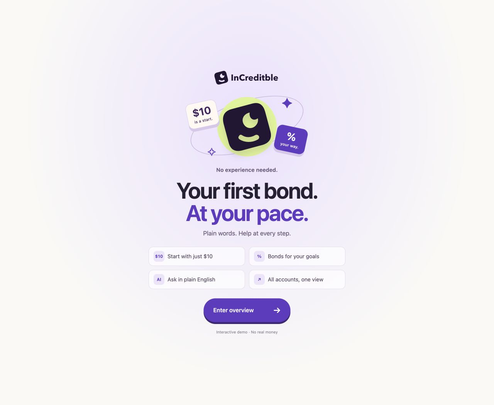
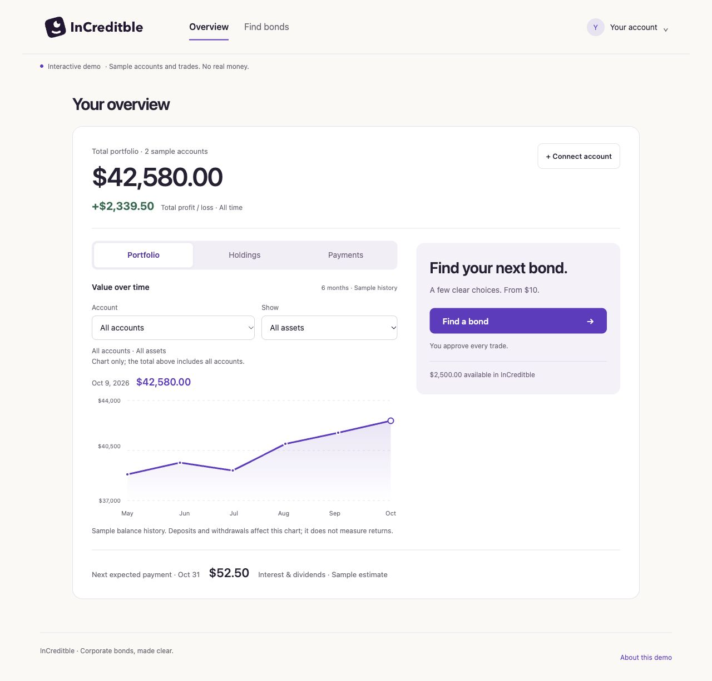
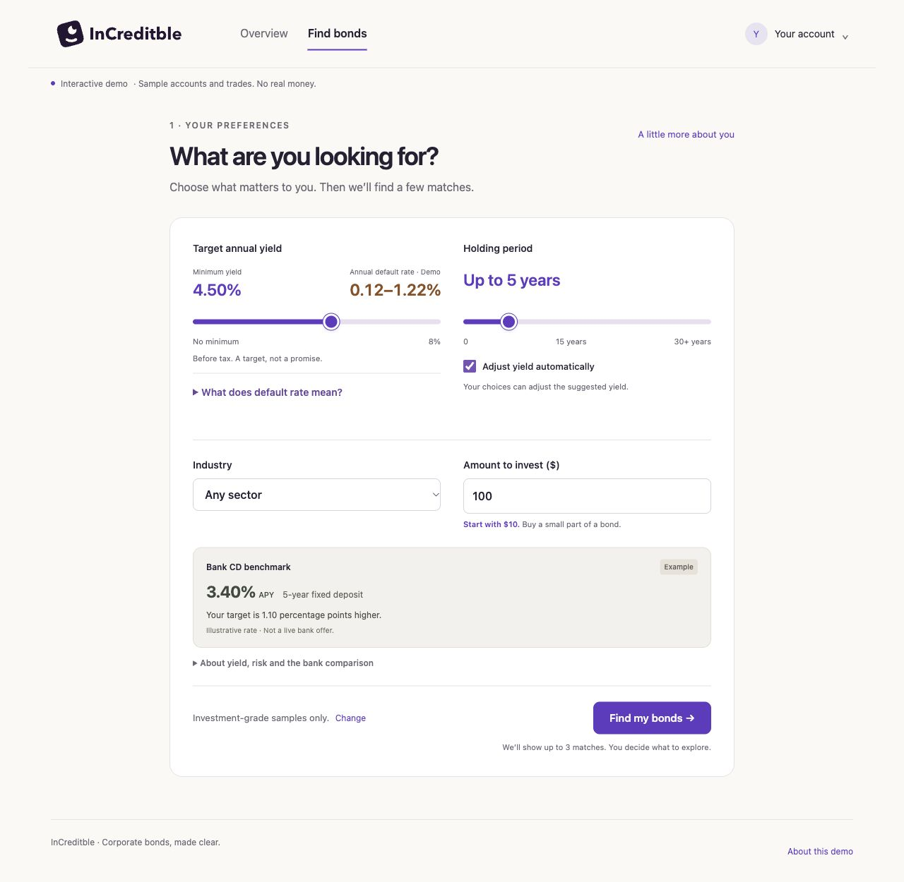
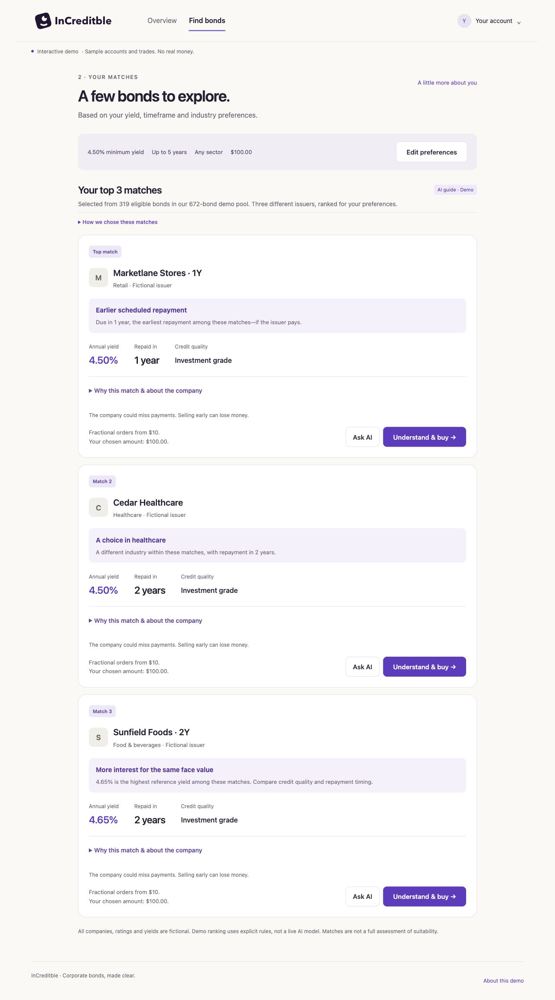
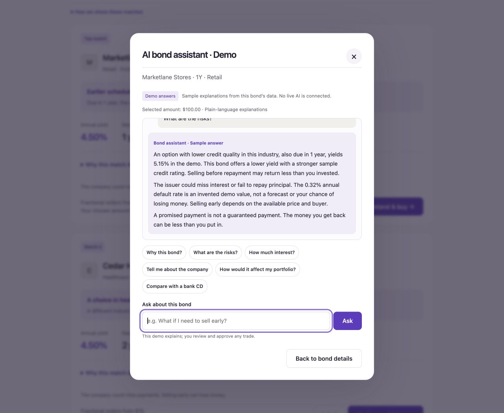
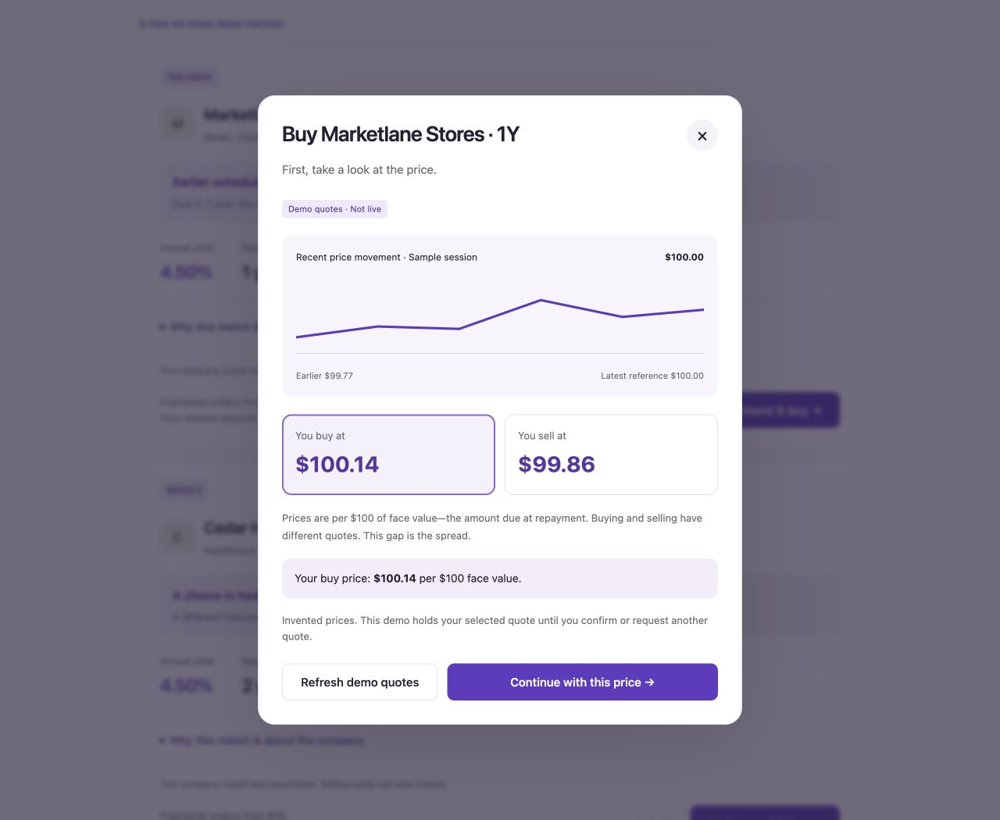
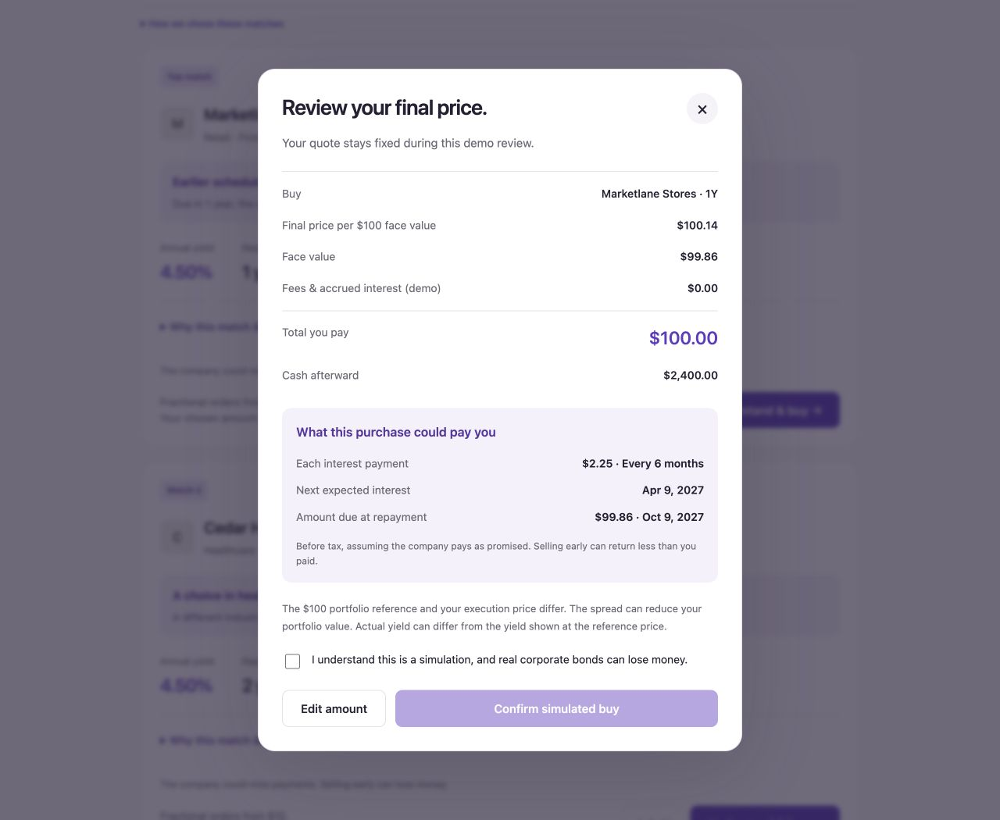
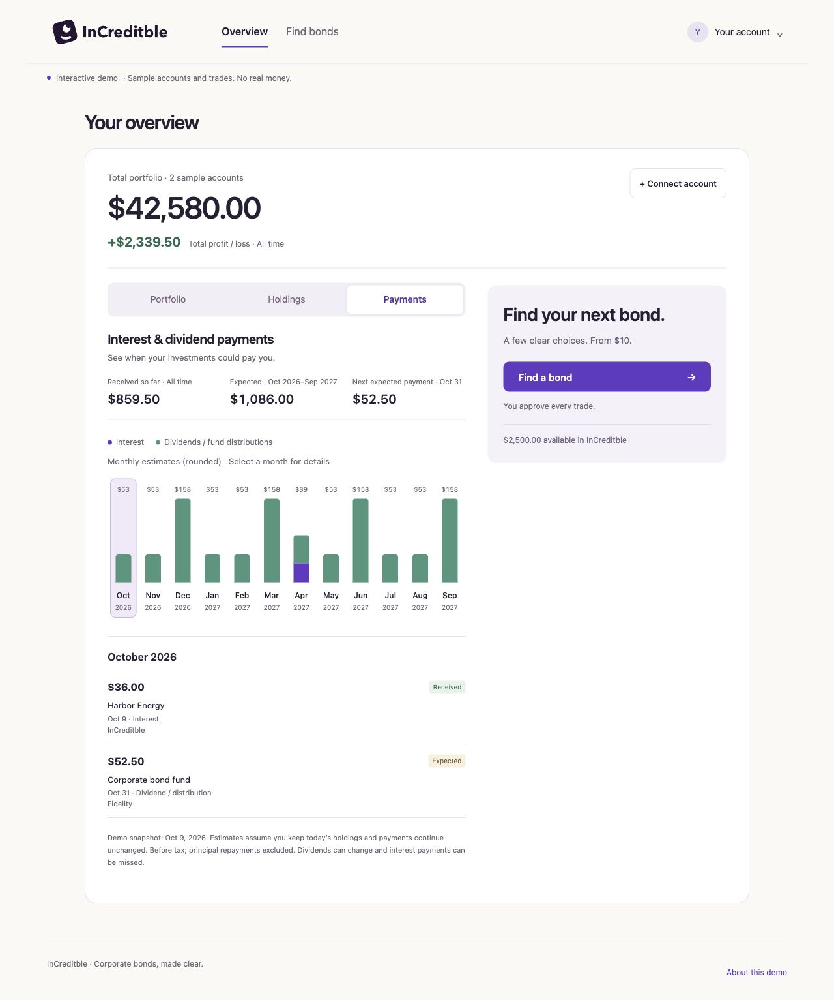

# InCreditble

**Your first bond. At your pace.**

InCreditble is a corporate-bond trading prototype for people who are new to investing, especially older adults who want clear explanations and a small first step. Start with a yield target, a timeframe and an industry. Compare up to three explained matches, explore a fractional purchase from $10, and review the price and payment schedule before approving a simulated trade.



## Demo & pitch

**Live presentation:** [Open the continuous 3-minute pitch](https://increditble.vercel.app/share/present/) · [Download PowerPoint with embedded demo](prototype/share/present/InCreditble-live-pitch.pptx) · [Speaker guide](prototype/share/present/SPEAKER_GUIDE.md). The 68-second product demo sits after the problem; the web presentation returns to the market slide when playback finishes.

| Material | Open or download |
| --- | --- |
| Latest pitch deck | [View 11 slides online](https://increditble.vercel.app/share/?view=slides) · [Download PowerPoint v8](prototype/share/InCreditble-pitch-v8.pptx) |
| Product demo video | [Watch the 2:25 demo](https://increditble.vercel.app/share/?view=video) · [Download MP4 v6](prototype/share/InCreditble-demo-v6.mp4) |
| Present it live | [Walkthrough](demo/LIVE_DEMO.md) · [Video narration](demo/PITCH.md) · [Judge Q&A](demo/JUDGE_QA.md) |
| Product & brand | [Positioning](demo/POSITIONING.md) · [WINK brand kit](https://github.com/IvyPei/InCREDITble/tree/main/brand/wink) |
| Complete demo bundle | [Download ZIP](https://github.com/IvyPei/InCREDITble/raw/refs/heads/main/demo/releases/InCreditble-demo.zip) · [Package checks](demo/PACKAGE_CHECK.md) |

The public sharing page needs no login. The latest video combines motion graphics, prototype illustrations, English narration and a bright original instrumental score. The editable 11-slide deck includes sources and speaker notes. Both end with team portraits and two member LinkedIn QR codes, with a separate mentor thank-you. The complete ZIP is an archived submission package; use the sharing page for the latest video and slides. [Try the live prototype](https://increditble.vercel.app/), or follow the local setup below.

## The problem we are solving

Our starting user is someone who can describe what they want from their savings but cannot confidently translate that goal into a bond order. They need to understand what a company does, when it should pay them, what the purchase costs and what could go wrong. InCreditble starts with those questions, without requiring a bond identifier such as a CUSIP.

The product hypothesis is that a short, explained path from a goal to an explicit decision can make a first bond purchase easier to understand. That is what this prototype lets us test.

## What we built

- **A focused finder.** Yield, holding period, industry and amount produce at most three distinct-issuer matches from 672 fictional bonds across 18 industries. User risk limits remain hard constraints. Repeated yield/term combinations receive less weight so alternatives are easier to compare.
- **Help at the right depth.** Simulated onboarding captures bond familiarity separately from risk preference. A contextual assistant interface explains the company, match, payments, pricing and risks using local sample responses.
- **Small, deliberate trades.** Fractional purchases start at $10 in the demo. Buy and sell flows show sample price movement, separate quotes, final cash cost or proceeds, expected interest and principal repayment. The user confirms each simulated order.
- **An overview that stays connected.** Sample external accounts appear alongside local holdings, with a portfolio chart, profit/loss and payment schedule. Transactions update cash and holdings, and demo progress survives refresh.

## A look inside

Actual screenshots from the interactive prototype. Companies, prices, accounts and trades shown are sample data.

### Your investments at a glance

See total value and profit/loss, filter the portfolio chart by account or asset type, and keep connected sample accounts visible. Holdings and Payments switch within the same focused overview.



### Start with your goals

Choose yield, holding period, industry and an amount from $10. Keep your own yield target or allow it to adjust with your selections.



<details>
<summary><strong>Compare three explained matches</strong></summary>

Each candidate highlights a useful difference, such as earlier repayment, a different industry or more interest. Company details and the rationale are available when needed.



</details>

<details>
<summary><strong>Ask for a plain-language explanation</strong></summary>

Explore why a bond matches, how the company works, or what could go wrong. The assistant shown here uses local sample responses and leaves the trade decision to the user.



</details>

<details>
<summary><strong>Understand the price before choosing an amount</strong></summary>

A sample price chart and separate buy/sell quotes make the spread visible before the order review. These are invented quotes, not a live market feed.



</details>

<details>
<summary><strong>Review what you pay and when the bond could pay you</strong></summary>

Review the cash cost, face value, remaining cash, expected interest and principal repayment date before confirming a simulated purchase.



</details>

<details>
<summary><strong>See the interest and dividend payment schedule</strong></summary>

Switch from the portfolio chart to Payments. Monthly estimates and individual entries distinguish expected payments from income already received.



</details>

## Try it locally

Requires Python 3. No API keys, npm install or build step.

```sh
python3 -m http.server 4173 --bind 127.0.0.1 --directory prototype
```

Open **http://127.0.0.1:4173/** and click **Enter overview**, then **Find a bond**. `npm run prototype` is an optional shortcut for the same server command.

For a repeatable demo, use **Your account → Settings → Reset demo progress → Reset demo**. Refresh shows the welcome screen and returns to Overview; saved trades and preferences remain until reset. Use the same browser and port to keep the same demo progress.

## How it works

The application is dependency-free HTML, CSS and JavaScript. Explicit filters enforce yield, industry, repayment horizon and the selected credit-risk limit. A deterministic scorer balances credit quality, target fit, repayment time, known local holdings and variety. Explanations use the same bond and preference data as the finder.

The quote module calculates fractional face value and settlement in integer cents. The portfolio tracks cash, cost basis and realized/unrealized profit or loss; expected payments remain separate from income already received. Versioned browser storage restores validated demo state.

See [prototype implementation notes](prototype/README.md) for the module map and assumptions.

## What is simulated

All issuers, market prices, yields, ratings, default rates, bank comparisons and account data are fictional. The assistant uses deterministic responses, not a connected AI model. KYC, account linking and trading are simulations; no credentials or identity documents are collected. No live brokerage, execution, custody or fractional-bond service is integrated. Fees and accrued interest are zero in the demo, and positions use a fixed $100 valuation reference. Real execution prices, liquidity and payments would differ.

## What comes next

Test whether first-time users can explain the price, expected payments and risks before confirming an order, and whether seeing existing accounts makes a separate bond experience useful. A production version would need verified security and quote data, a supported execution/custody model for fractional positions, actual identity and account-linking integrations, and grounded AI responses that can show sources and acknowledge missing information.

The current demo is the corporate-bond trading experience. Earlier payday and wealth-management materials are historical concepts, not capabilities of this version. No production or open-source license is asserted here.
